When I was working as a design and manufacturing engineer at Nanotech, one of my study fields was designing and testing machinability of highly brittle materials such as [fused silica](https://en.wikipedia.org/wiki/Fused_quartz), [alumina](https://en.wikipedia.org/wiki/Aluminium_oxide), and [PZT](https://en.wikipedia.org/wiki/Lead_zirconate_titanate). Machining these materials often requires specialised fixtures and tooling, particularly when dealing with freeform geometries. Although low feed rates are generally required to achieve high surface quality, workpiece setup methods, cutting angles, and cooling strategies become especially important in high-volume production. Below I described some strategies I followed.

## Challenges with Machining of Brittle Materials

- High relative part-tool orientation creates cutting force variations and lower surface quality and traces.
- Even a small amount of radial tool runout can cause vibrations and lead to edge cracking.
- Low cutting speeds can result in poor surface quality and even chipping on the machined surfaces. 
- Incorrect tool angles and inadequate cooling can reduce tool life and even cause sudden tool breakage. 
- Thin-walled structures and sharp edges easily led to unexpected material removal and requires special supports and fixturing strategies.

## 5-Axis Ultrasonic Granding Machines

I used a DMG ultrasonic grinding machine to machine ceramic and quartz materials. In addition to its full 5-axis machining capability, the machine is specifically designed for machining brittle materials that require high surface quality and complex geometries.

  <figure style="margin: 0; text-align: center;">
    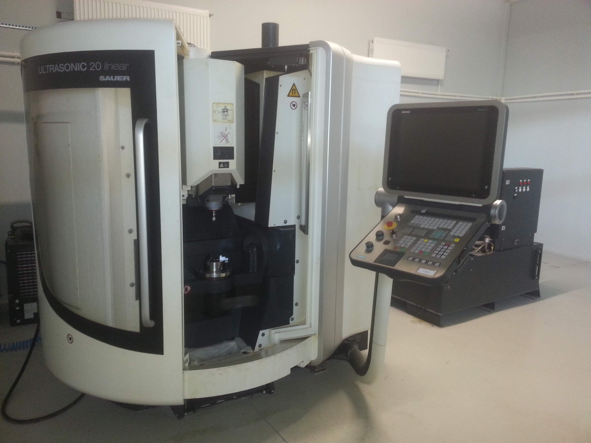
    <figcaption style="margin-top: 0.5rem; font-size: 0.9rem; color: #666;"><a href="https://uk.dmgmori.com/products/machines/ultrasonic/ultrasonic-precision/ultrasonic-20-linear-3rd" target="_blank" rel="noopener noreferrer">DMG Ultrasonic Linear</a> 5-axis Grinding Machine</figcaption>
  </figure>
  <figure style="margin: 0; text-align: center;">
    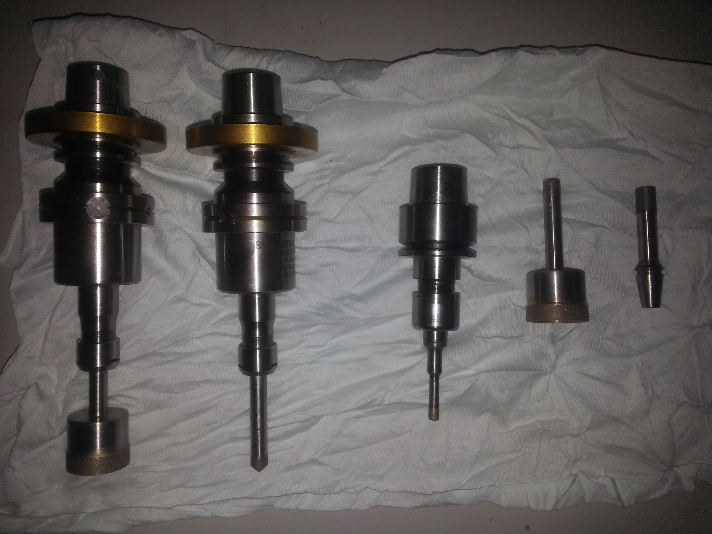
    <figcaption style="margin-top: 0.5rem; font-size: 0.9rem; color: #666;">Ultrasonic Tools for High Surface Quality</figcaption>
  </figure>

## Custom Grinding Tool Design

### Vertical Grinding Tools

Custom grinding tool design is particularly important for profile grinding operations. For cylindrical profiles, I designed the tools shown in the images to achieve a single-point contact and higher cutting forces. I also carried out the lathe operations in-house without refixturing to minimise runout.

  <figure style="margin: 0; text-align: center;">
    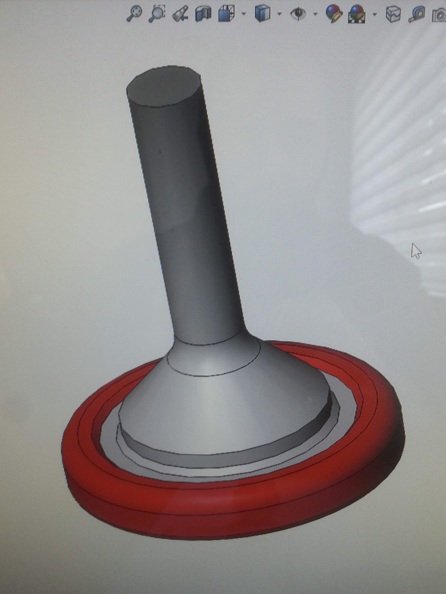
    <figcaption style="margin-top: 0.5rem; font-size: 0.9rem; color: #666;">Vertical Grinding Tool Design</figcaption>
  </figure>
  <figure style="margin: 0; text-align: center;">
    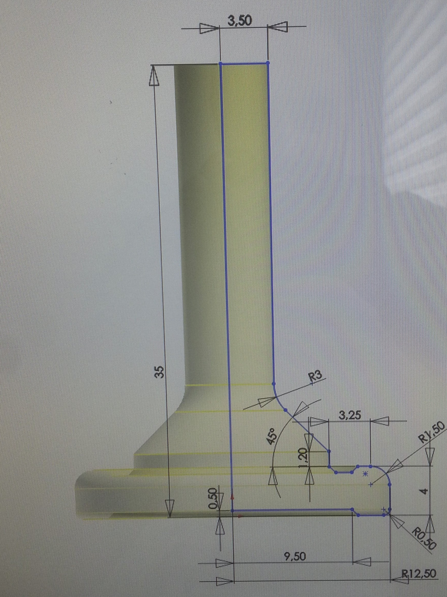
    <figcaption style="margin-top: 0.5rem; font-size: 0.9rem; color: #666;">Geometry of the Tool with Special Radius</figcaption>
  </figure>

### Horizontal Grinding Tools

I also designed horizontal tools for internal profile grinding. These tools can be easily mounted on and removed from a corresponding arbor, with a special tapered fit ensuring accurate alignment. The drill-like helical profile follows the internal geometry of the workpiece precisely, helping to minimise the contact area and improve coolant access, resulting in better tool performance.

I designed the tool in SolidWorks, generated the toolpath in hyperMILL, and machined the tool on a 5x machine before sending it for diamond coating. I then used the finished tool to grind the profile of a specialised ceramic workpiece.

  <figure style="margin: 0; text-align: center;">
    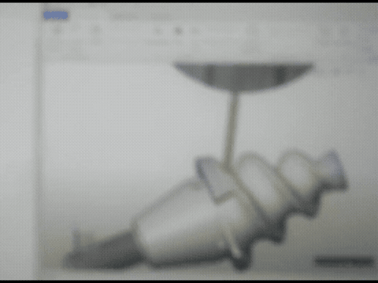
    <figcaption style="margin-top: 0.5rem; font-size: 0.9rem; color: #666;">CAM Simulation for Helical Horizontal Grinding Tool</figcaption>
  </figure>

  <figure style="margin: 0; text-align: center;">
    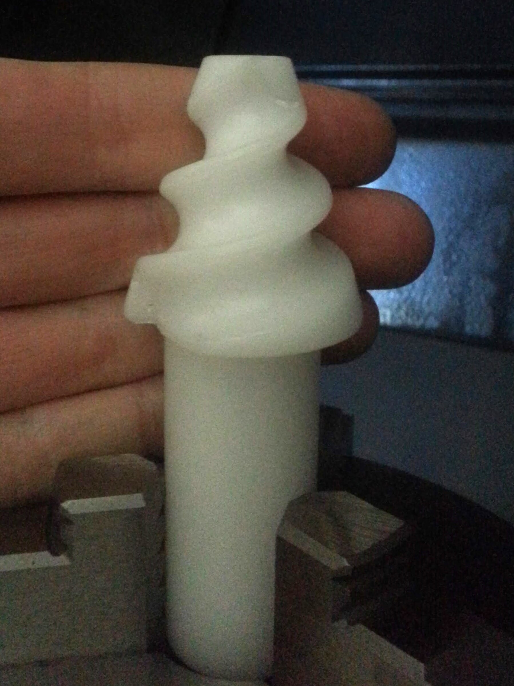
    <figcaption style="margin-top: 0.5rem; font-size: 0.9rem; color: #666;">Horizontal Tool Prototyping</figcaption>
  </figure>
  <figure style="margin: 0; text-align: center;">
    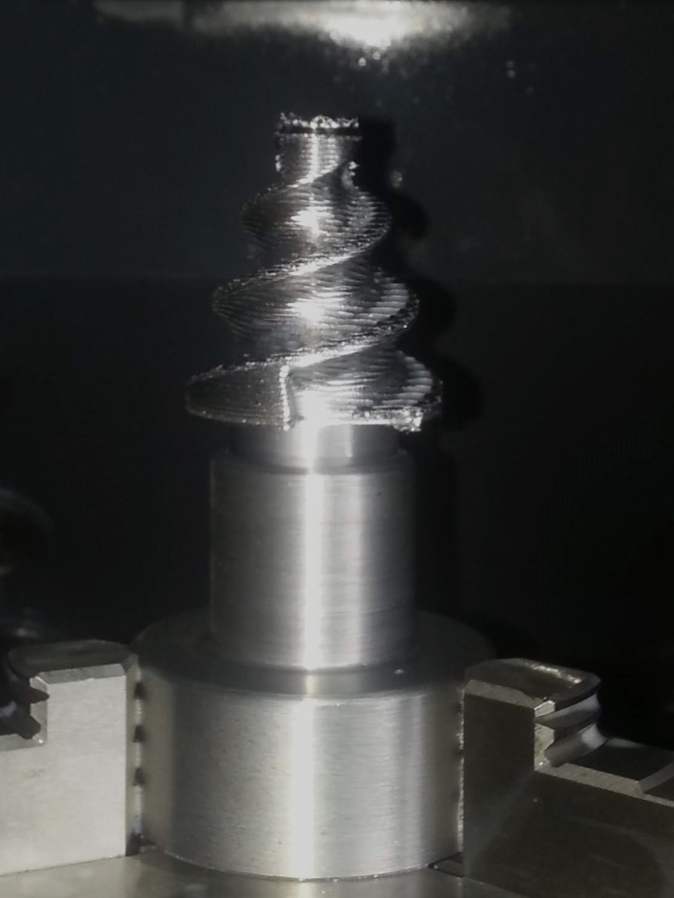
    <figcaption style="margin-top: 0.5rem; font-size: 0.9rem; color: #666;">Tool Geometry After Rough Cutting</figcaption>
  </figure>

## Manufacturing Simulation

For complex geometries, I used hyperMILL to generate grinding toolpaths and evaluate tool design and contact angles. This helped identify areas with lower cutting speeds and develop more effective cooling strategies. I also created a database of cutting parameters for ceramic and quartz materials within the software.

  <figure style="margin: 0; text-align: center;">
    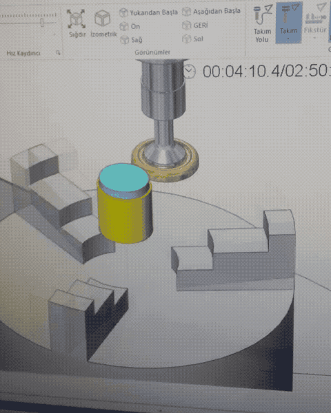
    <figcaption style="margin-top: 0.5rem; font-size: 0.9rem; color: #666;">Simulation of a Grinding Toolpath</figcaption>
  </figure>
  <figure style="margin: 0; text-align: center;">
    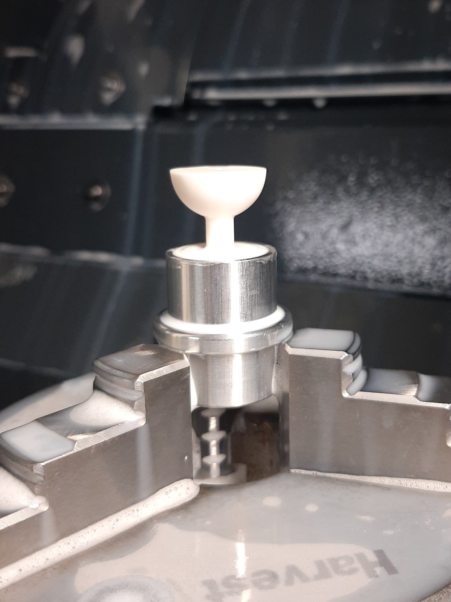
    <figcaption style="margin-top: 0.5rem; font-size: 0.9rem; color: #666;">A Final Ceramic Workpiece Geometry</figcaption>
  </figure>

## Fixture Design

Thin-walled structures require carefully designed support to prevent sudden cracking, particularly around sharp edges. Unlike conventional rigid supports, fixtures must be designed to minimise clamping forces on the workpiece. The animation shows an internal profile grinding fixture that I designed.

  <figure style="margin: 0; text-align: center;">
    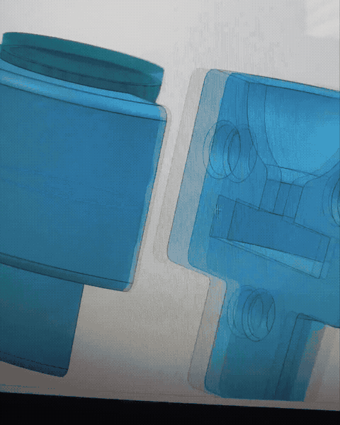
    <figcaption style="margin-top: 0.5rem; font-size: 0.9rem; color: #666;">A Custom Inner Profile Grinding Fixture I Designed</figcaption>
  </figure>

## Some Parts I Have Produced

#### Fused Quartz Wine-glass Gyro Shell

 [Quartz Wine-glass Gyros](https://en.wikipedia.org/wiki/Hemispherical_resonator_gyroscope) are used in spacecraft attitude and orbit control systems, as well as in submarine navigation systems. The central component is shaped like a hollow hemisphere, resembling the bowl of a wineglass or a mushroom cap. It is typically machined from a single piece of high-purity fused quartz.

  <figure style="margin: 0; text-align: center;">
    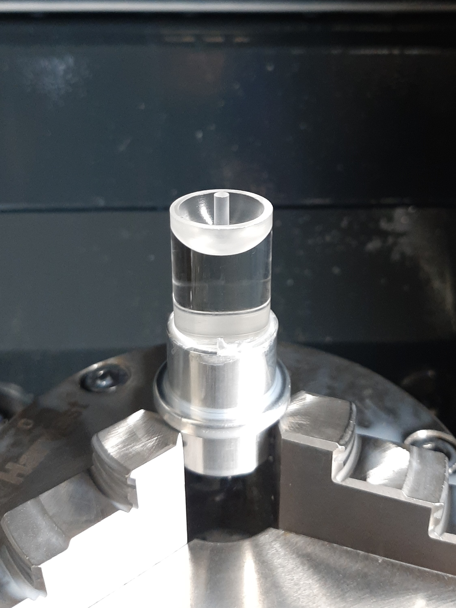
    <figcaption style="margin-top: 0.5rem; font-size: 0.9rem; color: #666;">Precision Quartz Gyro Shell Machining Process</figcaption>
  </figure>
  <figure style="margin: 0; text-align: center;">
    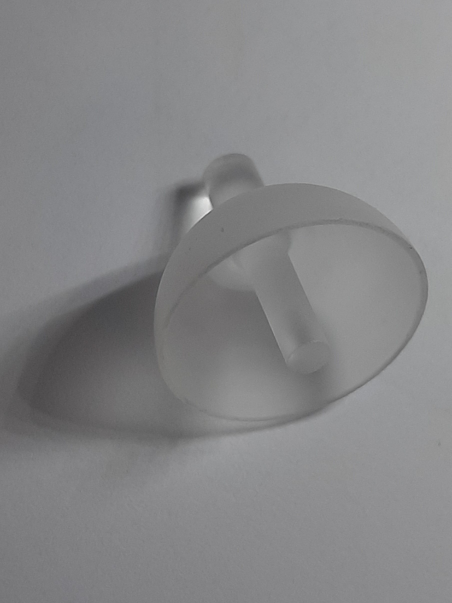
    <figcaption style="margin-top: 0.5rem; font-size: 0.9rem; color: #666;">Finished Fused Quartz Gyro Shell</figcaption>
  </figure>

#### Medical Test Device Parts ####

I have also machined several high-precision medical components, as shown in the images.

  <figure style="margin: 0; text-align: center; flex: 1 1 0;">
    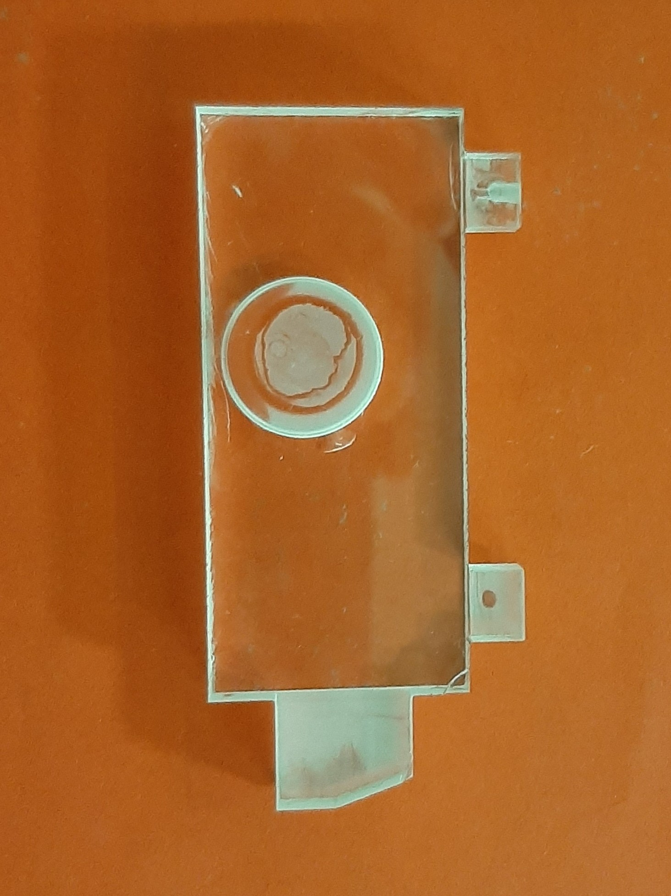
    <figcaption style="margin-top: 0.5rem; font-size: 0.9rem; color: #666;">High-Precision Medical Component Machining</figcaption>
  </figure>
  <figure style="margin: 0; text-align: center; flex: 1 1 0;">
    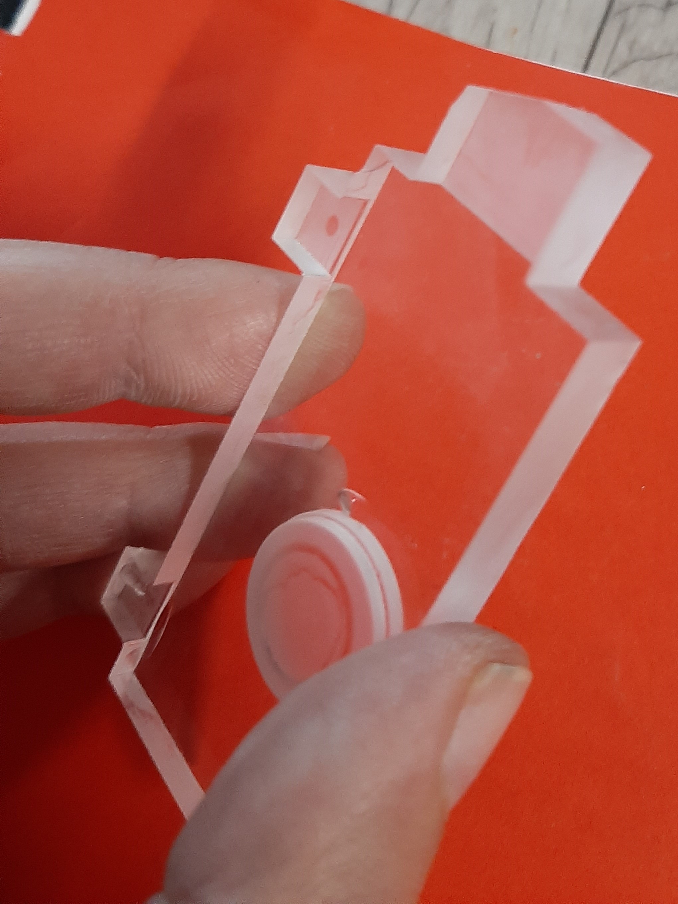
    <figcaption style="margin-top: 0.5rem; font-size: 0.9rem; color: #666;">Detail of the Machined Medical Part</figcaption>
  </figure>
  <figure style="margin: 0; text-align: center; flex: 1 1 0;">
    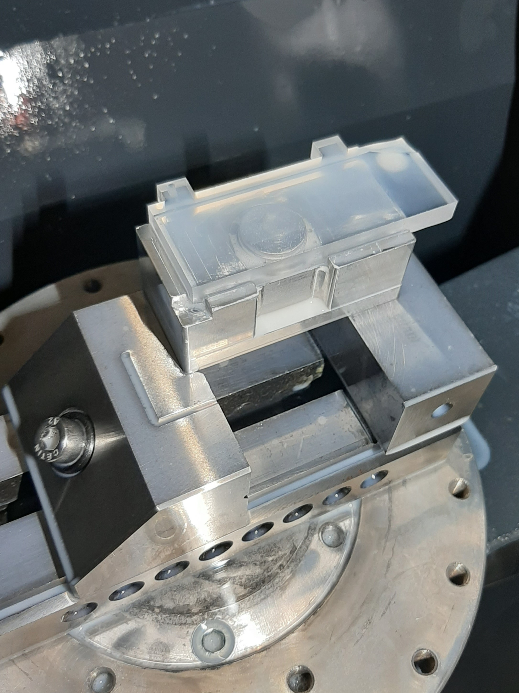
    <figcaption style="margin-top: 0.5rem; font-size: 0.9rem; color: #666;">Finished Workpiece</figcaption>
  </figure>

