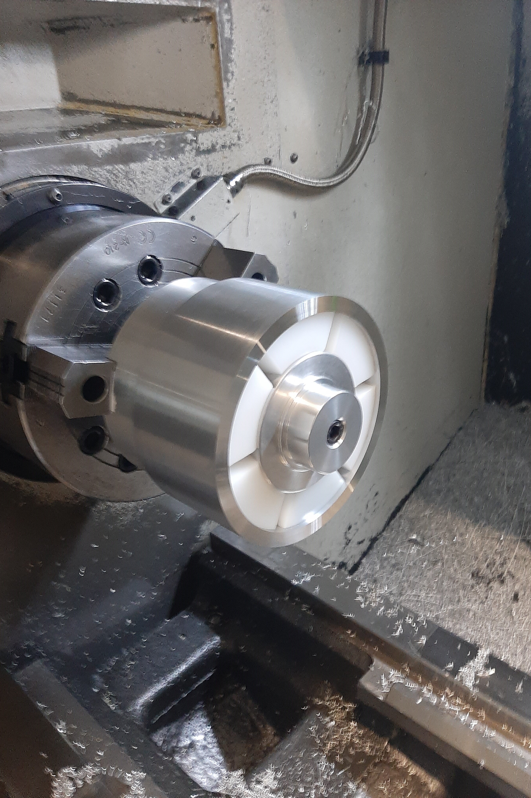
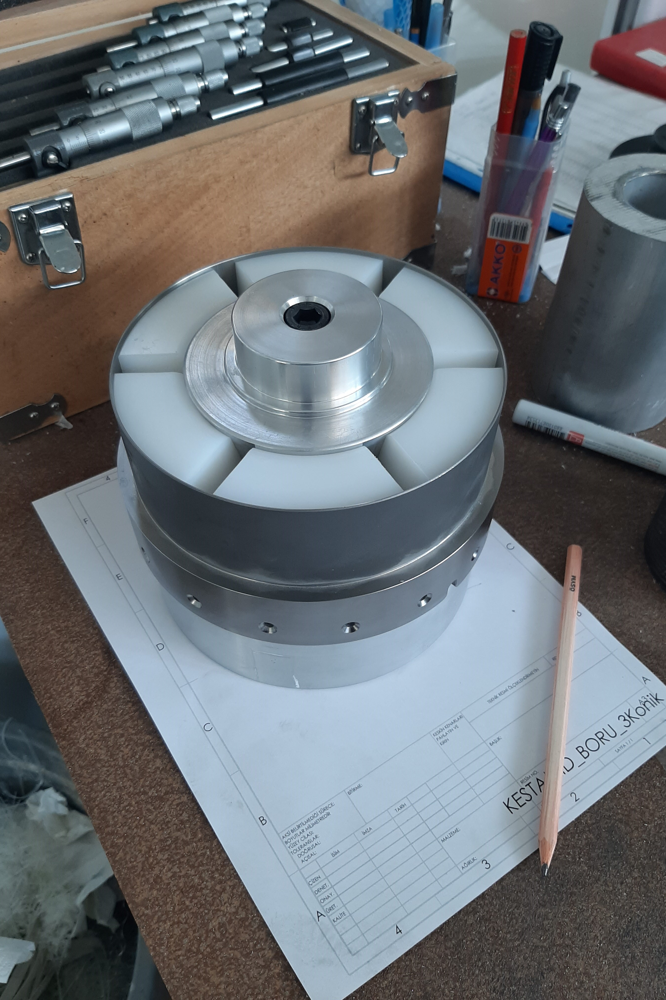
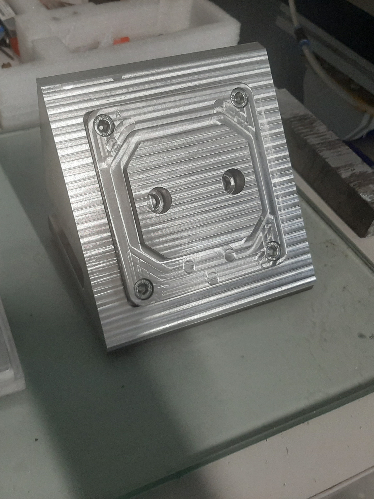
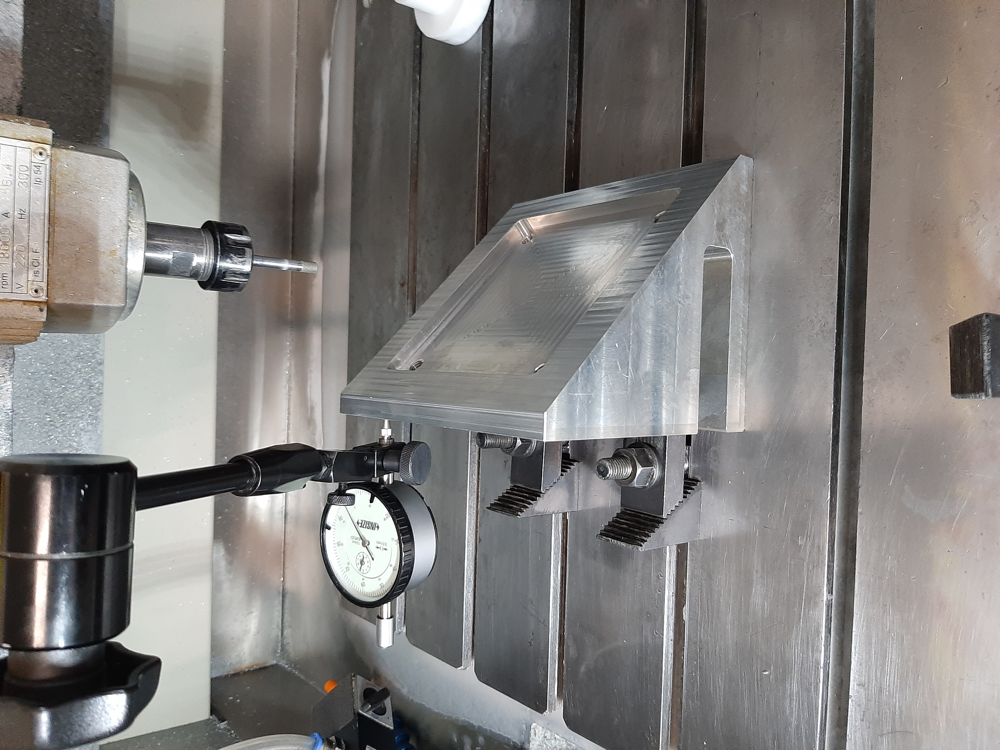

In the early years of my career as a design and manufacturing engineer, I spent considerable time working in a workshop environment. This included using basic measuring instruments on actual workpieces, applying fixturing techniques, selecting tooling, generating CAM toolpaths and G-code, and operating CNC machines.

I also completed Hexagon training courses in GD&T and CMM operation.

Below, I have included some visuals to briefly illustrate the practical tasks and activities I was involved in.

# Turning Operations

Below, I have included images of a fixture and internal support system that I designed to prevent chatter during the external machining of a flange with a wall thickness of just 1.8 mm.

The central aluminium component is threaded and moves axially when tightened, sliding into a tapered groove in the polymer (white) support component. This causes the polymer component to expand radially, providing internal support to the thin-walled structure during machining.

  <figure style="margin: 0; text-align: center;">
    
    <figcaption style="margin-top: 0.5rem; font-size: 0.9rem; color: #666;"><a href="https://uk.dmgmori.com/products/machines/ultrasonic/ultrasonic-precision/ultrasonic-20-linear-3rd" target="_blank" rel="noopener noreferrer">DMG Ultrasonic Linear</a> 5-axis Grinding Machine</figcaption>
  </figure>
  <figure style="margin: 0; text-align: center;">
    
    <figcaption style="margin-top: 0.5rem; font-size: 0.9rem; color: #666;">Ultrasonic Tools for High Surface Quality</figcaption>
  </figure>

# 5 Axis Milling

I generated CAM toolpaths using hyperMILL and operated 5-axis milling machines to machine workpieces with various angled features and freeform surfaces. Through machining a wide range of components, I gained practical experience in tool selection, machining parameter optimisation, tool magazine configuration, workpiece zero-point setting, and the use of machine jaws, support blocks, and custom fixtures.

  <figure style="margin: 0; text-align: center;">
    
    <figcaption style="margin-top: 0.5rem; font-size: 0.9rem; color: #666;"><a href="https://uk.dmgmori.com/products/machines/ultrasonic/ultrasonic-precision/ultrasonic-20-linear-3rd" target="_blank" rel="noopener noreferrer">DMG Ultrasonic Linear</a> 5-axis Grinding Machine</figcaption>
  </figure>
  <figure style="margin: 0; text-align: center;">
    
    <figcaption style="margin-top: 0.5rem; font-size: 0.9rem; color: #666;">Ultrasonic Tools for High Surface Quality</figcaption>
  </figure>

# Fixture Design

Here, I show a custom fixture that I designed for grinding the freeform surface of a ceramic component. For this operation, I selected a ball-shaped grinding tool, as it is particularly suitable for machining smooth, curved surfaces.

One of the main limitations of this tool geometry is that its peripheral cutting speed drops to zero at the bottom centre of the tool, making it unsuitable for grinding perpendicular surfaces.

To overcome this limitation, I developed a two-part fixture consisting of an angled fixed base, designed to avoid contact with the zero-velocity region of the grinding tool, and a removable section. Once the fixed fixture is accurately aligned with the machine axes, the removable section can be detached and replaced with a new workpiece without disturbing the original alignment.

  

    <figure style="flex: 1 1 0; margin: 0; text-align: center;">
      
      <figcaption style="margin-top: 0.5rem; font-size: 0.9rem; color: #666;"><a href="https://uk.dmgmori.com/products/machines/ultrasonic/ultrasonic-precision/ultrasonic-20-linear-3rd" target="_blank" rel="noopener noreferrer">DMG Ultrasonic Linear</a> 5-axis Grinding Machine</figcaption>
    </figure>
    <figure style="flex: 1 1 0; margin: 0; text-align: center;">
      
      <figcaption style="margin-top: 0.5rem; font-size: 0.9rem; color: #666;">Ultrasonic Tools for High Surface Quality</figcaption>
    </figure>
  

  <figure style="width: 100%; max-width: 840px; margin: 0; text-align: center;">
    
    <figcaption style="margin-top: 0.5rem; font-size: 0.9rem; color: #666;">Ultrasonic Tools for High Surface Quality</figcaption>
  </figure>

