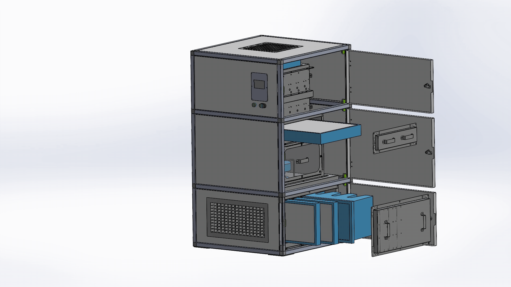
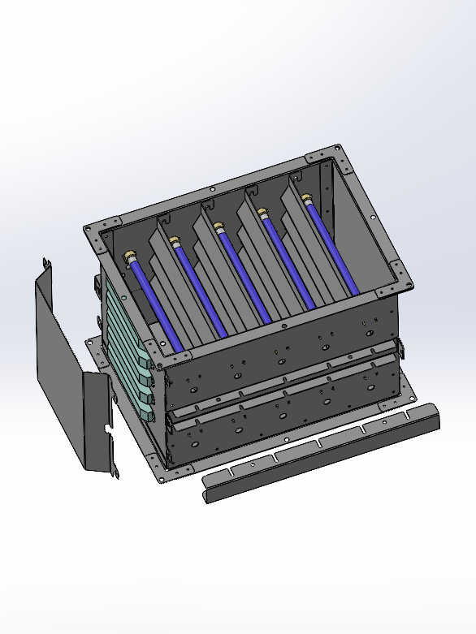
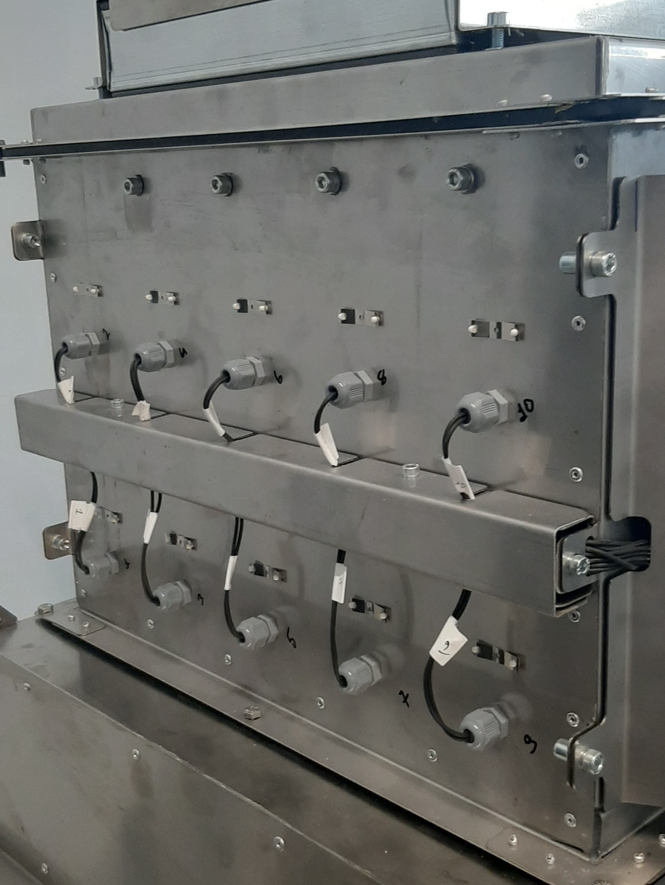
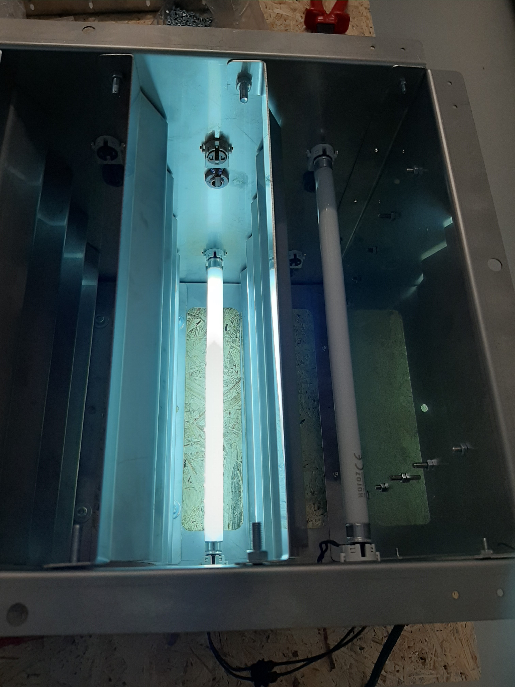
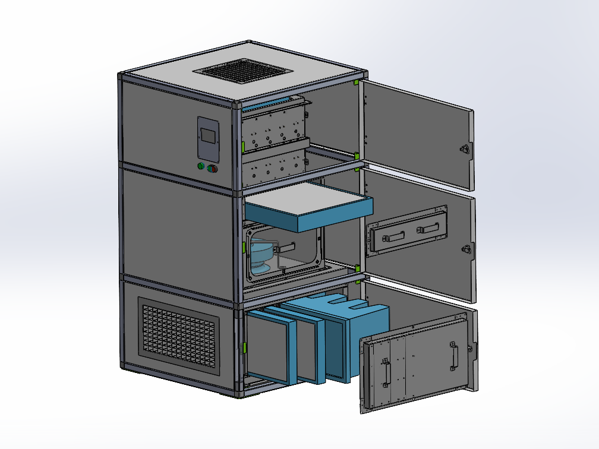
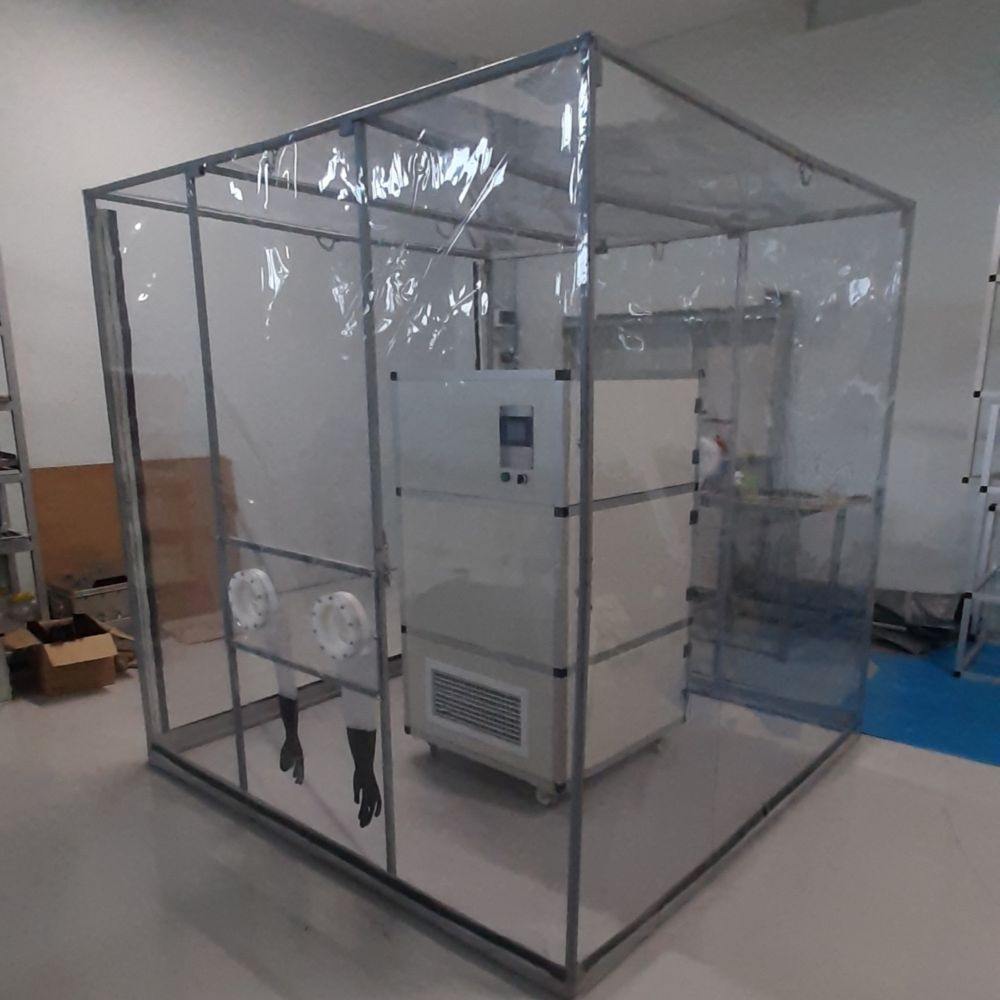
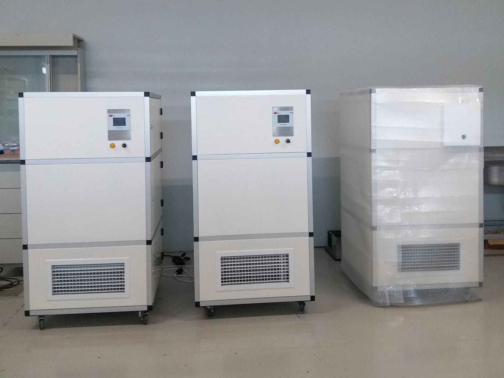
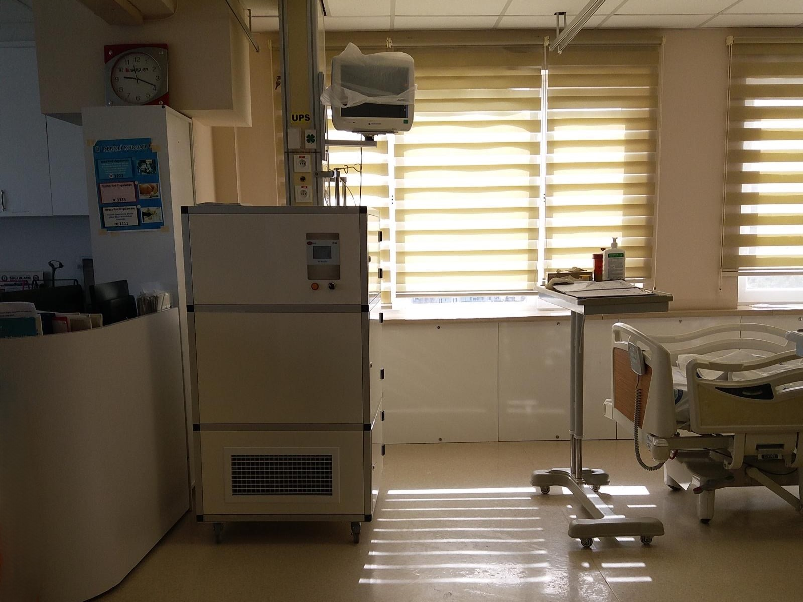

During the COVID-19 pandemic, I participated in an internal company project as a design engineer, contributing to the development of an air sterilisation device targeting healthcare facilities. In addition to conventional air filtration systems, we integrated a novel antibacterial technology into a dedicated treatment subsystem. This basically consisted of a chamber coated with antibacterial powder, which was activated by UV-C light. We internally referred to this subsystem as the "Death Chamber".

# Design Considerations

- The design must consist of standard components or parts that can be easily sourced from the market.
- The design must allow for in-house assembly using simple connection types such as rivets and screws.
- The device must be portable and able to pass through standard doorways.
- Airflow should not generate excessive noise at the inlet or outlet, or at any point within the device.
- Fan-induced vibrations must be controlled. Vibration-damping components must be considered if excessive vibrations occur during start-up and shutdown.
- Internal airflow must follow a continuous flow path, preventing air leakage.
- The device's airflow capacity must meet the requirements established by the bacterial testing calculations.
- Maintaince
- All internal electronic components, including UV-C lamps, and filters must be easily accessible for maintenance.
- The filter must be easy to install and remove.

# General Construction

I started by conducting market research to identify suitable structural and electronic components. For the outer body panels, I selected press-brake forming using mild steel sheets, while stainless steel sheets were chosen for the internal components. To ensure accurate alignment of the outer panels during assembly, I incorporated internal locating stops into the design. For the internal modules, I used a flanged construction to facilitate easy screw-based assembly.

I also prepared standard manufacturing and assembly drawings, organised a dedicated production line, and led and coordinated the assembly team.

{: width="700"}

# Internal Air Flow

The internal subsystems were dimensioned to maintain airflow velocities that would not generate excessive noise. They were also connected using airtight sealing materials to prevent air leakage.

# UV-Box Subsystem

The air needed to remain inside the chamber long enough to allow sufficient interaction between airborne bacteria and the antibacterial coating. Therefore, I designed the chamber dimensions accordingly. Additionally, I designed a zigzag-shaped internal baffle to increase the interaction area and improve contact between the airflow and the coated surfaces.

  <figure style="margin: 0; text-align: center; flex: 1 1 0;">
    
    <figcaption style="margin-top: 0.5rem; font-size: 0.9rem; color: #666;">UV-Box Internal Design View</figcaption>
  </figure>
  <figure style="margin: 0; text-align: center; flex: 1 1 0;">
    
    <figcaption style="margin-top: 0.5rem; font-size: 0.9rem; color: #666;">Air-Tight Cable Connecitons</figcaption>
  </figure>
  <figure style="margin: 0; text-align: center; flex: 1 1 0;">
    
    <figcaption style="margin-top: 0.5rem; font-size: 0.9rem; color: #666;">Assembly View</figcaption>
  </figure>

# Filters

I designed airtight filter compartment covers that allow easy access to the filters for replacement. For the HEPA filter, I also incorporated pressure measurement points to monitor the differential pressure drop across the filter and determine when it needs to be replaced.

{: width="700"}
_Filters can be easily removed by unscrewing the covers_

# Tests

I also designed a glove box to allow test engineers to carry out bacterial testing safely.

{: width="400"}

# Delivery

  <figure style="margin: 0; text-align: center;">
    
    <figcaption style="margin-top: 0.5rem; font-size: 0.9rem; color: #666;"><a href="https://uk.dmgmori.com/products/machines/ultrasonic/ultrasonic-precision/ultrasonic-20-linear-3rd" target="_blank" rel="noopener noreferrer">DMG Ultrasonic Linear</a> 5-axis Grinding Machine</figcaption>
  </figure>
  <figure style="margin: 0; text-align: center;">
    
    <figcaption style="margin-top: 0.5rem; font-size: 0.9rem; color: #666;">Ultrasonic Tools for High Surface Quality</figcaption>
  </figure>

