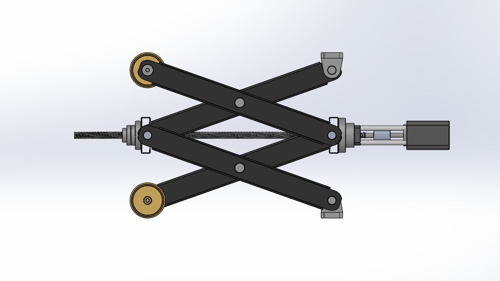
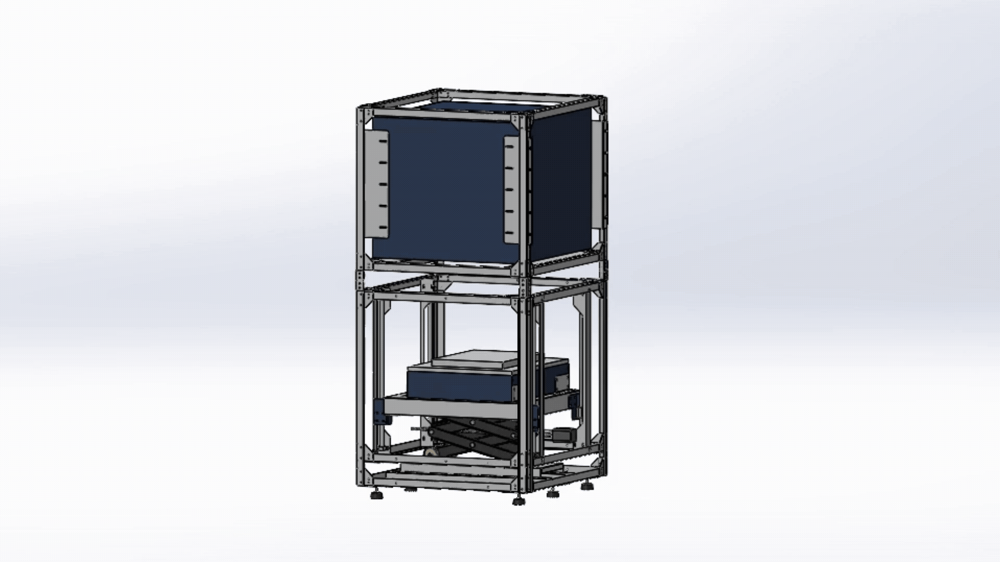
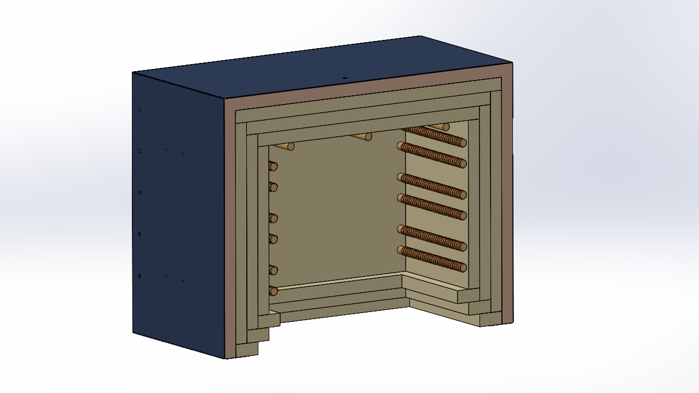
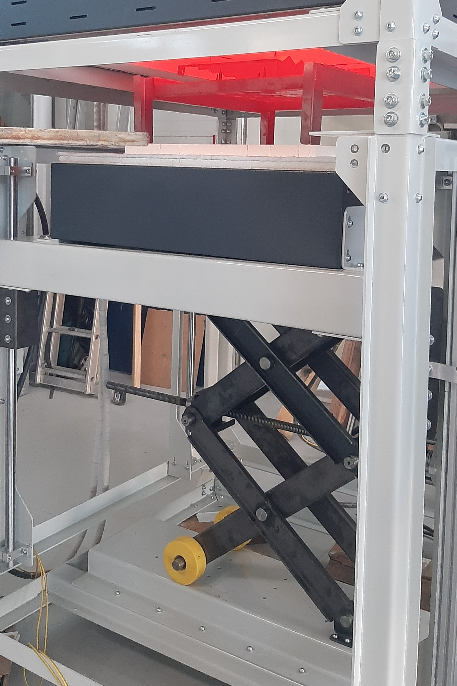
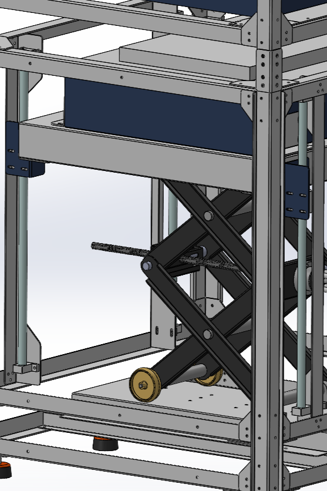

As part of a ceramic sintering production line, I designed a bottom-loading, vertical electric resistance furnace. In this type of furnace, the heating chamber remains stationary while the workpiece is raised into it, helping to minimise thermal shock to the furnace while reducing workpiece loading and unloading times.

Below, I describe the general design considerations and the main subsystems.

## Desing Considerations

- The design must provide sufficient clearance for workpiece loading and unloading.
- The minimum height of the scissor lift must be selected to avoid excessive motor torque during initial lifting. 
- The maximum height must also be limited to prevent the scissor arms from reaching a locked configuration.
- The design must allow for small positional adjustments to accommodate different workpiece dimensions.
- The furnace's internal temperature must remain as close as possible to steady-state conditions.
- Loading and unloading speeds must be controlled to minimise thermal shock to the furnace.
- The design must allow for straightforward in-house assembly.

## General Construction

The structure consists entirely of laser-cut and bent sheet-metal columns and beams. All parts are connected with bolts, and the holes have enough clearance and slots to avoid assembly problems caused by bending inaccuracies.

{: width="700"}

## Motion Mechanism

Before starting the design, I explored several possible lifting mechanisms. I selected a scissor lift because it provides more balanced load distribution across the structure. The lift carries the furnace bottom cover and the workpiece, while its movement is guided by four chrome-plated shafts and linear ball bearings. The lifting force is transmitted from the motor through a lead screw.

{: width="700"}

{: width="700"}

## Furnace Subsystem

I collaborated with a manufacturer on the furnace subsystem design to meet the required thermal performance and construction requirements. To ensure easy integration with the main structure after delivery, we used rivet nuts for assembly, allowing all connections to be made from one side.

{: width="700"}

## Final Assembly

  <figure style="margin: 0; text-align: center;">
    
    <figcaption style="margin-top: 0.5rem; font-size: 0.9rem; color: #666;">Final View</figcaption>
  </figure>
  <figure style="margin: 0; text-align: center;">
    
    <figcaption style="margin-top: 0.5rem; font-size: 0.9rem; color: #666;">Model View</figcaption>
  </figure>

