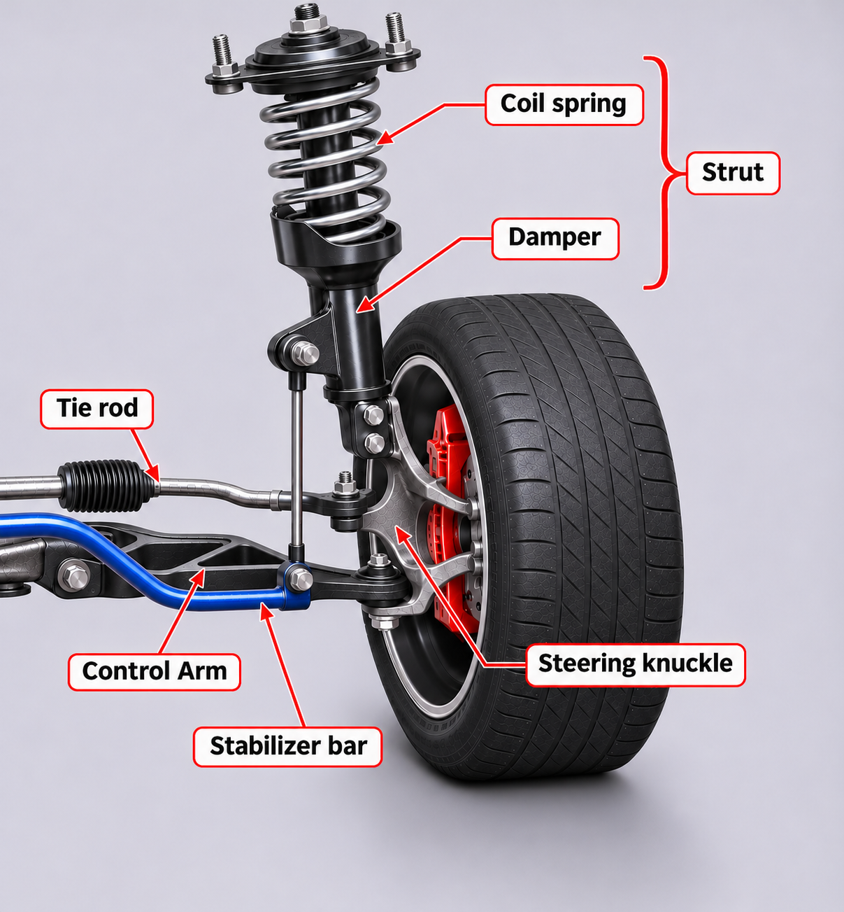
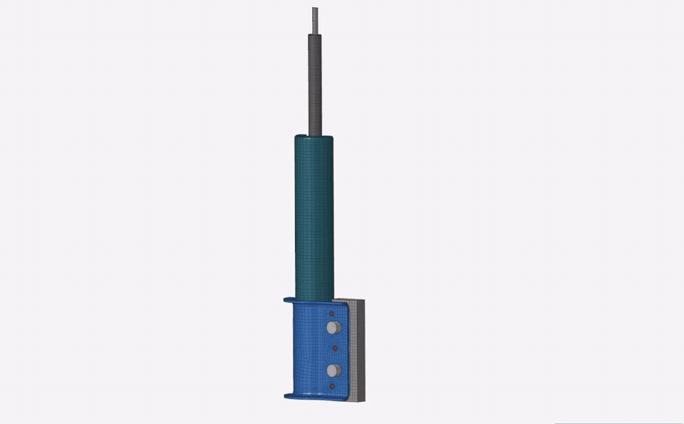
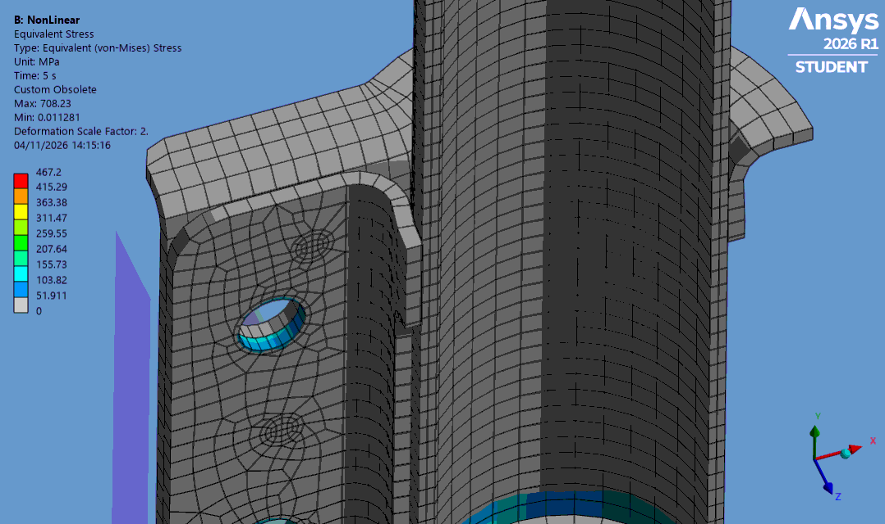
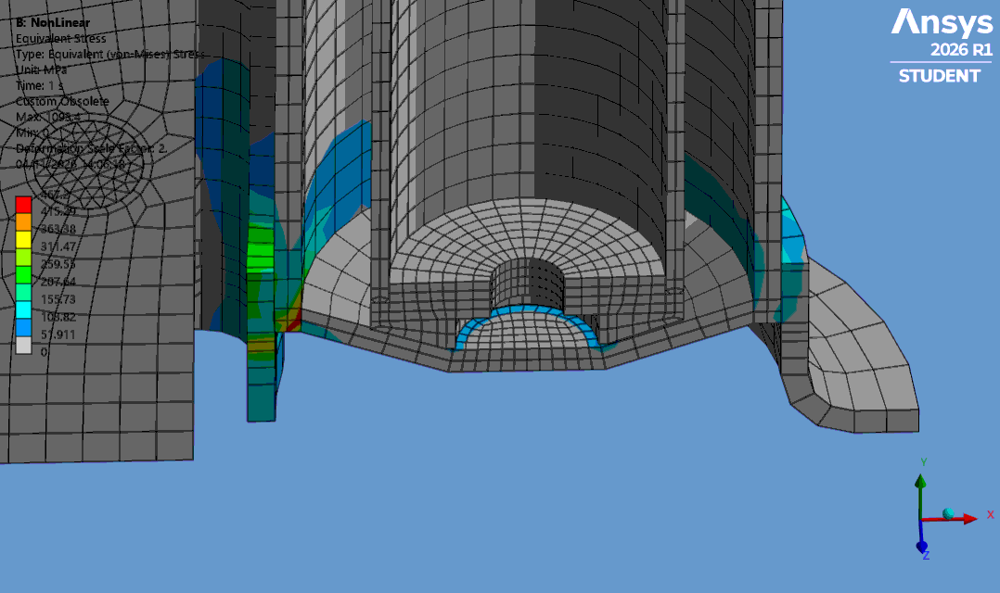
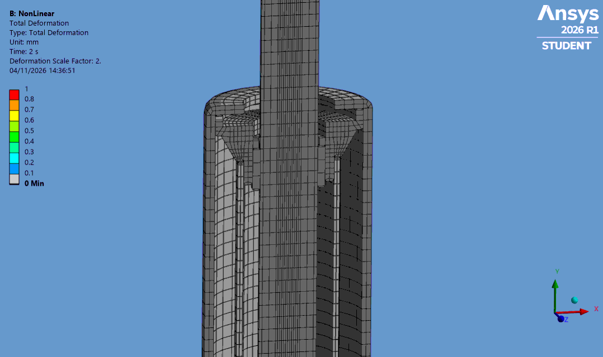
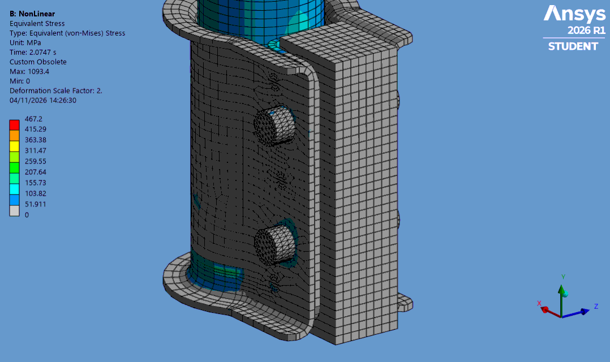
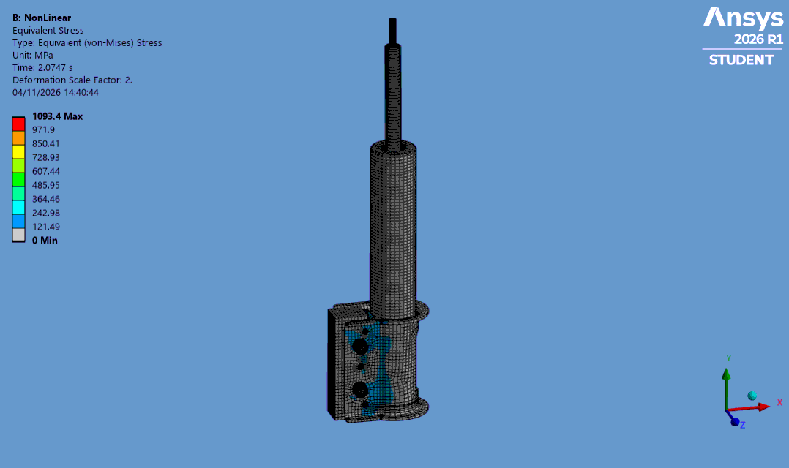
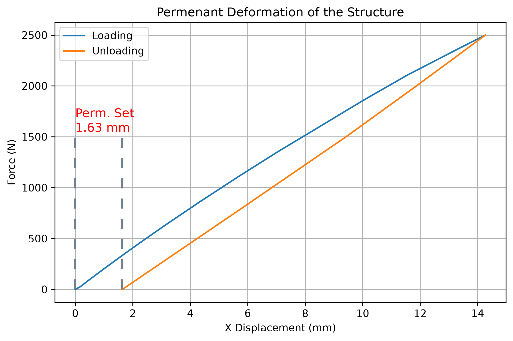

I worked as a Suspension Systems CAE Engineer at ZF, a global Tier 1 automotive supplier with more than 100 years of industry experience and a presence across multiple sectors. My main responsibility as a CAE Engineer was to deliver FEA analyses to design, test, and project engineers worldwide, following high internal quality standards.

Below, I have set up and run a simplified damper analysis to demonstrate the general scope and nature of the projects I worked on.

## Suspension Systems

The analyses I worked on mainly involved various suspension system components. These components are classified as safety-critical, as their failure could directly affect human safety. The loads acting on these components, their interactions, and the resulting load paths must therefore be carefully identified and analysed.

{: width="350"}

# Simulation of Suspension Systems

Each type of suspension systems and their components requires different kind of approach to model and analysis. The components must be clearly identified by their alignment, material properties, load data form, interactions and assement criteria. 

## Challenges

- CAD models must be checked for unwanted interference, incorrect dimensions, and misalignment.
- Model orientation and coordinate systems must match the load data.
- Load data units must be checked, and the data must be converted into a suitable input format.
- Material properties must meet the analysis requirements.
- Element types and mesh quality must be suitable for the expected physical behaviour, both locally and globally.
- Solver input files and output requests must be set up to reduce network data transfer and HPC resource usage.
- Nonlinear convergence data must be checked quickly to identify the causes of convergence problems.
- Results must be checked against internal quality standards and presented according to customer requirements.

## Meshing

Element types, mesh topology, and mesh quality are often major sources of numerical problems and computational challenges. At ZF, I used HyperWorks for pre-processing and mesh generation to meet internal modelling standards.

{: width="700"}

## Assembly Simulation

Suspension systems include orbital forming, welded and bolted joints, and shrink-fitting operations during subsystem and component assembly. To capture realistic pre-stresses and permanent deformations resulting from these processes, analyses usually start with assembly simulations, as shown below.

  <figure style="margin: 0; text-align: center; display: flex; flex-direction: column; align-items: center;">
    
    <figcaption style="margin-top: 0.5rem; font-size: 0.9rem; color: #666;">Tube Shrink Fit Simulation</figcaption>
  </figure>
  <figure style="margin: 0; text-align: center; display: flex; flex-direction: column; align-items: center;">
    
    <figcaption style="margin-top: 0.5rem; font-size: 0.9rem; color: #666;">Weld Activation/Deactivation</figcaption>
  </figure>
  <figure style="margin: 0; text-align: center; display: flex; flex-direction: column; align-items: center;">
    
    <figcaption style="margin-top: 0.5rem; font-size: 0.9rem; color: #666;">Tube Orbital Closing Simulation</figcaption>
  </figure>
  <figure style="margin: 0; text-align: center; display: flex; flex-direction: column; align-items: center;">
    
    <figcaption style="margin-top: 0.5rem; font-size: 0.9rem; color: #666;">Bolted Cennection Simulation</figcaption>
  </figure>

## Loading

Loads can take various forms, such as force vectors and application points, signal data from real-world measurements, or test data. For fatigue analysis, frequency-domain data from .rsp files can be used for random vibration fatigue analysis, while time-domain signals can be converted into equivalent load cycles using methods such as rainflow counting. Analysts must pay close attention to coordinate systems and units.

{: width="700"}

## Analysis Types

I performed nonlinear static, nonlinear buckling, post-buckling (arc-length), modal, and stress- and strain-based fatigue analyses. Depending on the project requirements, load-step strategies were often structured into multiple branches to compare and verify the results. 

## Running Analysis

I worked with the Abaqus solver on both local workstations and remote HPC clusters. I also developed a Python-based tool called Abaqus Debugger as part of an internal development project. The tool filters solver convergence data and generates visual tables and plots to help identify, understand, and resolve convergence problems.

## Post-Processing, Data Analysis, and Reporting

I used HyperView for FEA post-processing and Simcenter Durability 3D for fatigue analysis results. Typical post-processing outputs included plastic strains, equivalent and principal stresses, structural stiffness, permanent deformation, maximum, minimum and average stresses, fatigue damage, and weld fatigue life.

I also prepared FEA reports for both internal engineering teams and OEM customers, including BMW, Ford, BYD, Tesla, and Mercedes-Benz. 

{: width="500"}

