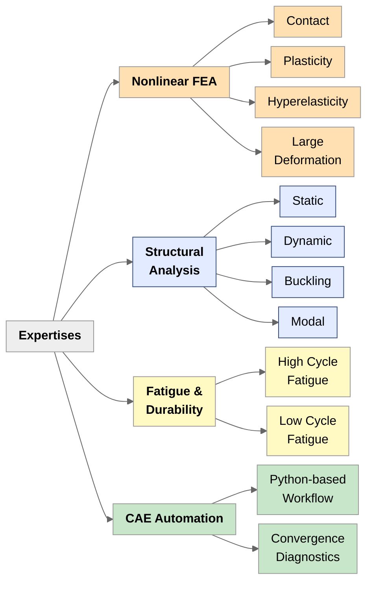

---
# the default layout is 'page'
icon: fas fa-info-circle
order: 4
mermaid: true
---

10+ years of industry experience in structural analysis, design, and manufacturing. Worked across automotive, energy, aerospace, and HVAC industries. Developed softwares for both engineering calculations and CAE workflows.

>Please check out my protfolio [here.](/categories/portfolio/)

## CORE EXPERTISE

## ENGINEERING TOOLS

{: width="700"}

## EMPLOYMENT HISTORY

### **CAE Engineer** | ZF Group | Automotive | 2022-2025
-------------------------------------------

  Performed nonlinear FEA and fatigue analyses of vehicle chassis components using detailed models (3–6 million DOF). Worked with steel, aluminium, plastic and rubber components using nonlinear material models. Modelled nonlinear contacts and joint behaviour including bolted joints and welded connections, under multiaxial loading conditions. Carried out random vibration fatigue, multi-event strain-life fatigue and IIW weld fatigue analysis.

#### *Key Achievements*

> Developed a software to diagnose convergence issues, reduce debugging time and improve model robustness in nonlinear FEA. 

> Participated in the global HyperWorks test user group to support and guide FEA team members in transitioning to the software’s latest updates, while adapting and improving existing modelling standards, templates, and procedures accordingly.

### **Structural Analysis Engineer** | Eltas Transformer | Energy | 2021-2022
-------------------------------------------

Performed FEA for structural static and dynamic problems involving transformer lifting and transportation, vacuum buckling, weld integrity, bolted joint behavior, and seismic loading scenarios. Also multiphysics analyses involving wind loads and thermal strain effects.

#### *Key Achievements*

> Developed a parametric CAD tool using the C# Autodesk Inventor API and the .NET Framework to enhance the analysis–to-design workflow.

### **Design and Manufacturing Engineer** | Nanotech | Aerospace | 2017-2021
-------------------------------------------

Designed mechanical components and systems, including shafts, flanges, dies, lifting jacks, flushing systems, and vacuum and pressure vessels. Participated in all stages of the engineering process, from conceptual design, CAD, technical drawings, and material selection to CAM programming, prototyping, testing and measurement (CMM), design reviews, and machining.

#### *Key Achievements*

> Designed motion-controlled bottom loading ceramic furnace for the main production line.

> Designed air sterilization device for healthcare facilities. 

### **Project Engineer** | ARS Cooling Systems | Energy | 2013-2016
-------------------------------------------

Designed industrial cooling system applications, performed design calculations, prepared 2D project drawings, and produced technical reports for project documentation.

## EDUCATION

**Mechanical Engineering** | Zonguldak Bülent Ecevit University | Turkey

## LANGUAGES

English  
Turkish 
